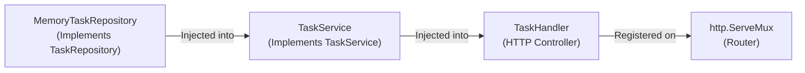
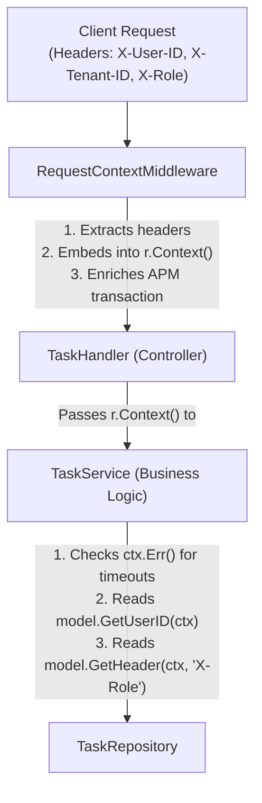

# Go API Service (Clean Architecture with net/http & CubeAPM Tracing)

A production-grade, idiomatic RESTful API service built in Go using standard library `net/http`, clean layered architecture, and **CubeAPM** distributed tracing.

---

## 🏛️ Architecture Overview

The project adheres to clean architecture principles with full distributed observability:

```
go-learn/
├── cmd/
│   └── api/
│       └── main.go              # Composition Root: DI wiring, APM tracer, HTTP server
├── internal/
│   ├── handler/                 # Controller / Transport Layer (HTTP)
│   │   ├── task_handler.go      # Request decoding, status mapping & response formatting
│   │   ├── task_handler_test.go # Controller tests with CubeAPM instrumentation
│   │   └── response.go          # Standardized JSON response & error utilities
│   ├── service/                 # Business Logic Layer (Domain Services)
│   │   ├── task_service.go      # Business rules, context checks, child span tracing
│   │   └── task_service_test.go # Unit tests with child span support
│   ├── repository/              # Persistence / Data Access Layer
│   │   ├── repository.go        # Storage interface (swappable with SQL, Mongo, etc.)
│   │   └── memory.go            # Thread-safe in-memory store (sync.RWMutex)
│   ├── model/                   # Domain Models & Context Abstraction
│   │   ├── context.go           # RequestContext, header accessors, context keys
│   │   ├── task.go              # Task struct, DTOs (CreateTaskInput, UpdateTaskInput)
│   │   └── errors.go            # Domain error sentinels (ErrNotFound, ErrForbidden, etc.)
│   └── middleware/              # Cross-cutting HTTP middlewares
│       └── middleware.go        # CubeAPM transaction labels, logging, recovery, CORS
├── go.mod
└── README.md
```

---

## 📚 Architectural & Engineering Concepts

### 1. 💉 Dependency Injection (DI) in Idiomatic Go

Unlike frameworks in Java (Spring) or Node.js (NestJS) that rely on heavy reflection containers and annotations, **Go embraces explicit, compile-time Constructor Injection**:



#### Why we do it:
1. **Single Source of Truth (`cmd/api/main.go` as Composition Root)**:
   All dependencies are instantiated and wired together in one place (`main.go`):
   ```go
   repo := repository.NewMemoryTaskRepository() // 1. Storage
   taskService := service.NewTaskService(repo)  // 2. Business logic depends on repo interface
   taskHandler := handler.NewTaskHandler(taskService) // 3. Controller depends on service interface
   ```
2. **Inversion of Control (IoC)**:
   `taskService` does **not** create or instantiate a database connection. It only accepts an interface (`repository.TaskRepository`).
3. **Frictionless Unit Testing**:
   Because dependencies are interfaces, you can swap the in-memory store for a mock, stub, or PostgreSQL database in unit tests without changing a single line of business logic.

---

### 2. 🌐 Context Propagation (`context.Context`)

In Go, `context.Context` is the standard mechanism to pass request lifecycles, cancellation signals, and request-scoped metadata across API boundaries.



#### The Problem Solved:
- **Clean Separation**: Business logic must remain pure Go. It should **never** import `net/http` or accept `*http.Request`.
- **The Solution**:
  1. [`RequestContextMiddleware`](internal/middleware/middleware.go) extracts incoming HTTP headers (`X-User-ID`, `X-Tenant-ID`, `X-Role`) and packages them into a clean domain struct [`model.RequestContext`](internal/model/context.go).
  2. The middleware injects this metadata into `r.Context()`.
  3. The controller passes `r.Context()` to the service.
  4. The business logic reads identity, tenant, or role via helper functions:
     ```go
     userID := model.GetUserID(ctx)
     role   := model.GetHeader(ctx, "X-Role")
     ```
5. **Cancellation & Deadlines**:
   If the HTTP client closes the browser tab or a timeout occurs, `ctx.Done()` signals immediately. The business service and database check `ctx.Err()` to abort expensive calculations early, preventing wasted server resources.

---

### 3. ⏱️ Traceability & APM Observability (Transactions vs. Spans)

Distributed tracing provides full visibility into every request as it travels through network hops, middlewares, business logic, and databases.

#### Anatomy of a Trace in CubeAPM

```text
TRACE: POST /api/v1/tasks (Total Latency: 12.0 ms)
─────────────────────────────────────────────────────────────────────────────
Component Name                        Duration    Timeline Visualization
─────────────────────────────────────────────────────────────────────────────
1. POST /api/v1/tasks [Transaction]    12.0 ms    [██████████████████████████]
2.   ├── Middleware & Routing           1.5 ms    [███]
3.   └── TaskHandler.Create             10.5 ms       [█████████████████████]
4.         ├── JSON Decode & Prep       1.2 ms        [██]
5.         ├── TaskService.CreateTask   8.0 ms            [██████████████]
6.         │     └── MemoryRepo.Create  2.0 ms                     [████]
7.         └── JSON Encode & Response   1.3 ms                           [██]
```

#### Core Concepts:
- **Transaction (The Root Scope)**:
  Created by `apmhttp.Wrap(...)`. Measures the complete end-to-end lifecycle from the moment the HTTP connection arrives until the last byte is written.
- **Child Spans (Granular Units of Work)**:
  Created by `apm.StartSpan(ctx, "TaskService.CreateTask", "app.service")`. Measures the specific execution duration of a business method or database query.
- **Where Does the Latency Go?**:
  - **Middleware Overhead (1.5 ms)**: Panic recovery guards, request context extraction, CORS headers, logger timers, and router path matching.
  - **Handler Work (2.5 ms)**: Reading the TCP socket stream, JSON deserialization (`json.NewDecoder`), and response marshaling (`json.NewEncoder`).
  - **Business Logic (8.0 ms)**: String trimming, rule validation, permission checks, and persistence calls.
- **Semantic Tagging**:
  Enriching active transactions (`tx.Context.SetUsername("usr_123")`, `tx.Context.SetLabel("tenant_id", "acme")`) allows engineers to query and filter traces in CubeAPM by user, company, or request ID.
- **Distributed Propagation**:
  CubeAPM adheres to the W3C Trace Context standard (`traceparent` and `tracestate` headers), allowing traces to propagate seamlessly across downstream microservices.

---

## 🔍 CubeAPM Distributed Tracing Integration

**CubeAPM** natively ingests distributed traces via the OpenTelemetry/Elastic APM protocol. Every incoming HTTP request and internal service operation is automatically traced:

1. **HTTP Transactions (`apmhttp.Wrap`)**:
   In [`cmd/api/main.go`](cmd/api/main.go), the root handler is wrapped with `apmhttp.Wrap(wrappedHandler)`. This records every API endpoint as a transaction with HTTP method, path, response status code, and latency.
2. **Context & Metadata Enrichment**:
   [`internal/middleware/middleware.go`](internal/middleware/middleware.go) enriches active CubeAPM transactions with user identifiers (`SetUsername`), `tenant_id`, and `request_id` labels.
3. **Business Logic Child Spans**:
   [`internal/service/task_service.go`](internal/service/task_service.go) creates child spans (`apm.StartSpan(ctx, "TaskService.CreateTask", "app.service")`) to trace execution time inside domain logic and automatically sends errors using `apm.CaptureError`.
4. **Panic Tracking**:
   The recovery middleware captures unhandled runtime panics and forwards them to CubeAPM before returning a 500 error.

### CubeAPM Configuration Variables

Configure these environment variables to connect to your CubeAPM server:

| Variable | Description | Default |
|---|---|---|
| `ELASTIC_APM_SERVICE_NAME` | The service name displayed in CubeAPM | `go-learn-api` |
| `ELASTIC_APM_SERVER_URL` | CubeAPM server ingestion URL | `http://localhost:3130` |
| `ELASTIC_APM_ENVIRONMENT` | Environment name (e.g. `production`, `staging`, `dev`) | `development` |
| `ELASTIC_APM_LOG_LEVEL` | Agent log level (`error`, `warning`, `info`, `debug`) | `info` |

---

## 🚀 Getting Started

### 1. Run the API Server with CubeAPM

```bash
# Optional: Set CubeAPM server URL (defaults to http://localhost:3130)
export ELASTIC_APM_SERVER_URL="http://localhost:3130"
export ELASTIC_APM_SERVICE_NAME="go-learn-api"

go run ./cmd/api
```

### 2. Run All Tests

```bash
go test -v ./internal/...
```

---

## 📡 API Endpoints & Traced Headers

| Method | Endpoint | Description |
|---|---|---|
| `POST` | `/api/v1/tasks` | Create a new task (attaches user & tenant from headers) |
| `GET` | `/api/v1/tasks` | List all tasks |
| `GET` | `/api/v1/tasks/{id}` | Get a task by ID |
| `PUT` | `/api/v1/tasks/{id}` | Update a task by ID |
| `DELETE` | `/api/v1/tasks/{id}` | Delete a task by ID |
| `GET` | `/health` | Health check endpoint |

#### Example: Create Task with Tracing & Identity Headers
```bash
curl -X POST http://localhost:8080/api/v1/tasks \
  -H "Content-Type: application/json" \
  -H "X-User-ID: usr_456" \
  -H "X-Tenant-ID: acme" \
  -d '{"title": "Deploy to Production", "description": "Verify traces in CubeAPM"}'
```

#### Example: Role-Based Business Check (Rejected via Context Check)
```bash
curl -X POST http://localhost:8080/api/v1/tasks \
  -H "Content-Type: application/json" \
  -H "X-Role: read-only" \
  -d '{"title": "Unauthorized attempt"}'
```
**Response (`403 Forbidden`):**
```json
{
  "error": "forbidden: insufficient permissions: read-only users cannot create tasks"
}
```
